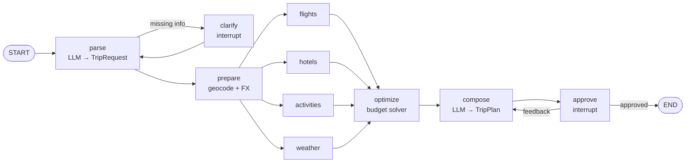

<p align="center">
  
</p>

# ✈️ Wayfinder: AI Travel Agent

A multi-agent trip planner built with **LangGraph**, **FastAPI** and **React + Vite**.
Runs entirely on **free** LLMs (Groq, Gemini, Hugging Face) and free open data APIs.

## Architecture



| Concern | Approach |
|---|---|
| LLMs | Groq → Gemini → Hugging Face with automatic fallback (`app/llm.py`) |
| Human-in-the-loop | `interrupt()` for clarifying questions and plan approval/feedback |
| Parallelism | flights, hotels, attractions and weather run concurrently, then fan-in |
| Memory | SQLite checkpointer; conversations survive restarts (`GET /api/threads/{id}`) |
| Grounding | LLM output is validated with Pydantic; dates and coordinates are overwritten from real data, hallucinated places are dropped |
| Budget | Deterministic optimizer (`app/optimizer.py`), unit-tested, not left to the LLM |
| Streaming | Server-Sent Events: live agent steps, partial results, interrupts |
| Data | Open-Meteo, OpenStreetMap (Nominatim + Overpass), Frankfurter FX, optional SerpAPI (Google Flights/Hotels) |
| Honesty | Anything not from a live API is labelled `source: "demo"` and flagged in `warnings` |

## Run it

Two terminals. The Vite dev server proxies `/api` to the backend, so there's no CORS setup.

```bash
# 1) backend (Python 3.11+)
cd backend
python -m venv .venv && source .venv/bin/activate
pip install -r requirements.txt
cp .env.example .env            # add GROQ_API_KEY and/or GOOGLE_API_KEY
uvicorn app.main:app --reload --port 8000

# 2) frontend (Node 18+)
cd frontend
npm install
npm run dev                     # http://localhost:5173
```

Tests: `pytest` in `backend/`, `npm test` in `frontend/` (no API keys needed).

## Frontend highlights

React 18 + TypeScript + Vite, no UI framework, hand-written CSS on design tokens.

- Light theme by default, dark mode toggle (remembers choice, no flash on load)
- Live "flight path" timeline showing the four parallel agents working at once
- Itinerary by day with weather, numbered stops and a MapLibre map (lazy-loaded)
- Cost breakdown against budget, flight and stay comparison
- Approve or request changes in chat; export to calendar (`.ics`) or PDF (print)
- Accessible: keyboard focus, ARIA tabs/live regions, reduced-motion, mobile layout

## Backend details

```bash
cd backend
python -m venv .venv && source .venv/bin/activate   # Python 3.11+
pip install -r requirements.txt
cp .env.example .env                                # add GROQ_API_KEY and/or GOOGLE_API_KEY
uvicorn app.main:app --reload --port 8000
pytest                                              # no keys needed
```

Free keys: [Groq](https://console.groq.com) · [Google AI Studio](https://aistudio.google.com) ·
[SerpAPI](https://serpapi.com) (optional, for live flights/hotels).

### Try it

```bash
curl -N localhost:8000/api/chat -H 'content-type: application/json' \
  -d '{"message":"Madrid to Amsterdam, 4 nights next month, 2 people, 3000 EUR, love food and museums"}'
```

SSE events: `thread` · `step` (agent activity) · `update` (node results) · `interrupt` (needs your input) · `error` · `done`.
Resume a paused run with `{"thread_id": "...", "resume": "Amsterdam"}` or
`{"thread_id": "...", "resume": {"approved": false, "feedback": "more food spots"}}`.

## Roadmap
- [x] LangGraph workflow, tools, streaming API, tests
- [x] React + Vite frontend (chat, activity timeline, flight/hotel cards, map, itinerary, dark mode)
- [x] `.ics` calendar export, print-to-PDF
- [ ] Pick a different flight/hotel and re-price, email delivery
- [ ] Eval suite + Langfuse tracing, Docker, CI, deployment
