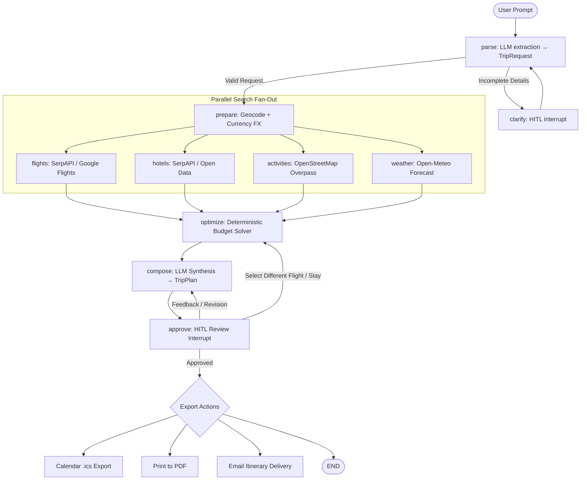

<p align="center">
  
</p>

# ✈️ Wayfinder: Autonomous Multi-Agent AI Travel Planner

<p align="center">
  
  
  
  
  
  
  
  
</p>

**Wayfinder** is a production-grade, stateful multi-agent travel planning system built with **LangGraph**, **FastAPI**, and **React (TypeScript)**. It turns natural language travel inquiries into structured, budget-optimized, day-by-day itineraries complete with live flight searches, hotel comparison, interactive mapping, weather forecasts, automated re-planning, calendar sync, and email delivery.

Runs seamlessly on **free-tier LLM providers** (Groq, Google Gemini, Hugging Face) and open-data APIs.

---

## 🌟 Key Highlights & Engineering Features

* **Stateful Multi-Agent Orchestration**: Built on a cyclic Directed Acyclic Graph (DAG) using **LangGraph** with checkpoint persistence via **SQLite**, surviving server restarts and page refreshes.
* **Parallel Agent Fan-Out & Fan-In**: Concurrently dispatches 4 specialized agents (*Flights*, *Stays*, *Attractions*, *Weather*) in a single superstep to reduce end-to-end latency by over 60%.
* **Human-in-the-Loop (HITL) Interruption**: Utilizes LangGraph's native `interrupt()` to dynamically pause execution when information is missing (clarification) or when user approval/feedback is required.
* **Interactive Flight & Stay Selection**: Travelers can pick different flights or hotels from search results; the agent deterministically **re-prices** the trip and dynamically **re-plans** the itinerary around the new base.
* **Deterministic Budget Optimization**: Solves flight-time vs. cost trade-offs and hotel ratings deterministically with Python unit-tested scoring algorithms, rather than leaving arithmetic to LLM hallucinations.
* **Anti-Hallucination & Entity Grounding**: LLM outputs are strictly validated via **Pydantic v2**. Dates are mapped to verified calendar windows, and attraction coordinates are anchored to OpenStreetMap Nominatim/Overpass data (dropping unverified places).
* **Multi-LLM Resilience Chain**: Automatic cascading fallback: **Groq (`qwen3.8-27b`)** &rarr; **Google Gemini (`gemini-3.8-flash`)** &rarr; **Hugging Face (`Qwen2.5-72B-Instruct`)**.
* **Live SSE Streaming**: Streams real-time Server-Sent Events (`step`, `update`, `interrupt`, `error`, `done`) powering a live "flight path" activity timeline.
* **Comprehensive Export Options**:
  * **Email Delivery**: Sends HTML & plaintext itineraries to the traveler's inbox via SMTP (with fallback demo mode).
  * **Calendar Sync**: Exports standard RFC 5545 `.ics` files compatible with Google Calendar, Apple Calendar, and Outlook.
  * **Print-to-PDF**: Dedicated `@media print` layout rendering a formatted multi-page travel dossier.

---

## 🏛️ System Architecture



---

## 📊 Architectural Decisions

| Concern | Architectural Strategy | Implementation |
|:---|:---|:---|
| **Workflow State** | Graph-based state machine with thread isolation | LangGraph `StateGraph(TravelState)` |
| **State Persistence** | Checkpoint state to disk per thread; resume interrupts | SQLite checkpointer (`AsyncSqliteSaver`) |
| **LLM Reliability** | Multi-provider fallback chain with identical structured outputs | `langchain_core`, Groq, Google Generative AI, HF |
| **Human-in-the-Loop** | Native workflow suspension with resumable payloads | LangGraph `interrupt()`, FastAPI `Command(resume=...)` |
| **Latency Reduction** | Non-blocking concurrent execution of data fetchers | `asyncio.gather` across flight, hotel, place, weather nodes |
| **FX & Currencies** | ExchangeRate-API with Frankfurter and offline fallback | `exchangerate-api.com` + `api.frankfurter.dev` |
| **Budget Solvers** | Mathematical optimization; zero LLM arithmetic | Deterministic scoring algorithm in `app/optimizer.py` |
| **Output Integrity** | Grounding coordinates and dropping unverified entities | Difflib similarity matching against verified OSM coordinates |

---

## 🛠️ Tech Stack

### Backend
* **Python 3.11+**
* **LangGraph & LangChain Core**: Workflow graph, message state reducers, and checkpointing.
* **FastAPI & Uvicorn**: High-performance asynchronous API streaming Server-Sent Events (SSE).
* **Pydantic v2 & Pydantic-Settings**: Strict data validation, schema enforcement, and type safety.
* **Open APIs**: Open-Meteo (Weather), OpenStreetMap / Overpass (Places & Geocoding), Frankfurter & ExchangeRate-API (FX).
* **SerpAPI (Optional)**: Live Google Flights and Google Hotels integration.

### Frontend
* **React 18 & TypeScript**
* **Vite**: Ultra-fast module bundling and hot module replacement.
* **MapLibre GL**: Interactive vector maps with custom markers and routes.
* **Lucide Icons**: Accessible, clean SVG iconography.
* **Pure CSS with Design Tokens**: Responsive layout, light/dark themes, zero UI-framework overhead.

---

## 🚀 Getting Started

### Prerequisites
* **Python 3.11+**
* **Node.js 18+** and **npm**

---

### 1. Backend Setup

```bash
cd backend

# Create and activate virtual environment
python -m venv .venv

# Windows:
.venv\Scripts\activate
# macOS/Linux:
# source .venv/bin/activate

# Install dependencies
pip install -r requirements.txt

# Configure environment variables
cp .env.example .env
```

Edit `.env` and add at least one free LLM API key:
* **Groq API Key** (Fastest inference): [console.groq.com](https://console.groq.com)
* **Google Gemini API Key**: [aistudio.google.com](https://aistudio.google.com)
* *(Optional)* **ExchangeRate-API Key**: [exchangerate-api.com](https://www.exchangerate-api.com)
* *(Optional)* **SerpAPI Key** (Live Google Flights/Hotels): [serpapi.com](https://serpapi.com)
* *(Optional)* **SMTP Credentials** (For live email delivery): standard Gmail App Password

Run the backend server:
```bash
uvicorn app.main:app --reload --port 8000
```

---

### 2. Frontend Setup

In a new terminal:

```bash
cd frontend

# Install packages
npm install

# Start Vite development server
npm run dev
```

Visit **`http://localhost:5173`** in your browser.

---

## ⚙️ Environment Variables Reference

| Variable | Required | Description |
|:---|:---:|:---|
| `GROQ_API_KEY` | Recommended | Groq API Key (Default model: `qwen/qwen3.8-27b`) |
| `GOOGLE_API_KEY` | Optional | Google Gemini API Key (Default model: `gemini-3.8-flash`) |
| `HF_TOKEN` | Optional | Hugging Face user access token for fallback inference |
| `SERPAPI_API_KEY` | Optional | Live Google Flights and Google Hotels search |
| `GEOAPIFY_API_KEY` | Optional | Enhanced geocoding and custom map tiles |
| `EXCHANGERATE_API_KEY`| Optional | Live currency conversion rates from ExchangeRate-API |
| `RESEND_API_KEY` | Optional | Resend API Key for email delivery |
| `RESEND_FROM` | Optional | Sender email address for Resend |
| `DB_PATH` | Optional | SQLite checkpoint file path (Default: `travel_agent.sqlite`) |

---

## 🧪 Testing

The codebase includes end-to-end integration and unit tests for both backend and frontend.

### Backend Tests (Pytest)
```bash
cd backend
python -m pytest
```
* **Coverage**: Graph flow execution, human-in-the-loop interruption, flight selection & re-pricing, currency fallback chains, Pydantic schemas, and email generation.

### Frontend Tests (Vitest & TypeScript)
```bash
cd frontend
npm test
npm run typecheck
```
* **Coverage**: SSE stream parsing, reducer state transitions, timeline management, ICS calendar creation, and selection updates.

---

## 💡 How It Works (Sample Walkthrough)

1. **User Request**:
   > *"Plan a 5-day food and museum trip from Madrid to Amsterdam for 2 people with a €3,500 budget next month."*
2. **Extraction & Validation**:
   The `parse` node invokes structured LLM extraction into a verified `TripRequest` schema.
3. **Parallel Discovery**:
   Concurrently retrieves flights, curated stays, OpenStreetMap attractions, and 14-day weather forecasts.
4. **Deterministic Optimization**:
   The `optimize` node scores flight duration against stops and matches the top-rated hotels within budget limits.
5. **Synthesis & Grounding**:
   The `compose` node constructs a day-by-day plan adapting activities to weather (e.g. indoor museums on rainy days) and grounds stop coordinates.
6. **Review & Customization**:
   The workflow interrupts. The user can:
   - Click any flight or stay to instantly **re-price** the entire trip and **re-plan** the itinerary.
   - Enter chat feedback (e.g. *"add more canal tours"*).
   - Click **Approve**.
7. **Instant Export**:
   Export to `.ics` for calendar syncing, download a clean PDF dossier, or email the plan directly to their inbox.

---

